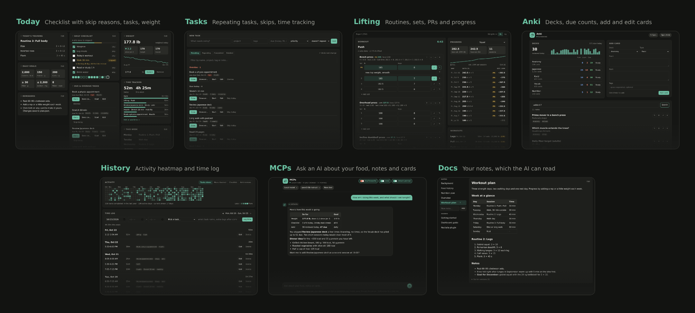

# Daily Dashboard

**Your self-hosted, open-source dashboard for lifting, food and daily habits, with an AI assistant that keeps them up to date for you.**



Log your sets, reps and weights as you train, and track your PRs and bodyweight trends over time. Your calories and macros sit alongside your lifts, with a daily checklist, tasks and time tracking, plus your flashcards if you study. and an AI assistant can log meals, plan your training and answer questions about your data.

It takes the place of a workout logger, a food diary app, a weight tracker and a to-do list, all on one place.

- **Today:** workout, checklist with streaks, weight trend, calories and macros from MyFitnessPal (log and edit foods right there), lifting progress, tasks due, Anki cards due, time tracked. Drag the cards to arrange them.
- **Tasks:** [Taskwarrior](https://taskwarrior.org) tasks with repeating schedules, skips with reasons, and time tracking in [Timewarrior](https://timewarrior.net).
- **Lifting:** routines with days of exercises, a workout logger that fills in last time's weights, rest and hold timers, supersets, optional exercises and quick swaps, notes per set, each set's estimated 1RM as you type, PRs and progress charts. Finishing a workout can tick its task and log the time.
- **Anki:** decks and due counts, add cards, search and edit notes, and your review history in History (through the AnkiConnect add-on).
- **History:** activity heatmap, activity feed, time log.
- **MCPs:** chat with an AI that can use the [MyFitnessPal](https://github.com/Mason-Levyy/myfitnesspal-mcp) and [Anki](https://github.com/ankimcp/anki-mcp-server) MCPs, add and change your Taskwarrior tasks, and search the web: "what should I eat tonight?", "log 2 eggs for breakfast", "make flashcards from my notes", "add a task to call the dentist on Friday". Use Claude with your own key, or a model running on your own computer.
- **Docs:** your own notes (goals, nutrition plan, workout plan…), which the AI can also read.
- **Noctalia bar plugin** (optional): checklist, due tasks and a task timer on the [Noctalia](https://github.com/noctalia-dev/noctalia-shell) bar.

More screenshots in [`screenshots/`](screenshots/).

## Why it works

Food, training, tasks and study usually live in separate apps. Here they share one screen, so a single check-in replaces four.

- **One daily check.** Workout, checklist, remaining macros, tasks due and Anki cards due are all on Today.
- **One history.** Food, workouts, tasks, skips, tracked time and flashcard reviews are collected together, so a day or a week is easy to look back on.
- **Skips come with context.** Any task can be skipped, but every skip asks why: sick, traveling, no time, didn't feel like it, or your own words. Skip from the Tasks tab or the Today card, and a repeating task rolls on to its next occurrence. The reason is saved and shows in the History feed and heatmap next to what you completed.
- **An AI that can review it.** It reads the same data, skip reasons included. Ask "what should I eat tonight?" and it works from your remaining macros and today's workout. Ask "why was last week bad?" and it can go through your skips, food and reviews together.
- **Your plan next to your results.** Your goals and plans live in Docs, so you (and the AI) can compare what you meant to do with what you did.

Reasons are what make the data useful. Three skipped workouts that say "tired" point at sleep or food. Three that say "no time" point at your schedule. Without them, all you have is a broken streak, and you and the AI are both guessing.

Each piece also works alone. MyFitnessPal and Anki take a few minutes to link (steps 3 and 4 in [Make it yours](#make-it-yours)).

## Why the AI is built in

Tracking only helps if you keep it up to date, and that upkeep is what kills the habit. The AI does the busywork so you can spend your time on the habits themselves. And since all your data is in one place, it can help you review your routine and plan what to change next.

- **Turn conversations into actions.** "Log 2 eggs and toast for breakfast" goes into MyFitnessPal without you opening the app or hunting through its food database. Talk through a new plan and it can set your target macros for you.
- **Help with your training.** Ask "build me a 3-day routine around my goals" or "what should I change in my plan?", and it works from your training plan and the workout notes in Docs.
- **Cards without the chore.** Point it at your notes and it drafts flashcards into Anki. Ask it to find, fix or tidy up existing cards and decks, and it edits them for you.
- **Advice that fits your week.** Your tasks, your plan and the notes you write about your goals are there for the AI to draw on, so you get answers about your week instead of generic tips.

The dashboard works fine without it. To switch it on, add a key or a local model on the Account page (step 5 in [Make it yours](#make-it-yours)).

## Get started

You need [Nix](https://nixos.org/download) with flakes, and [Taskwarrior 3](https://taskwarrior.org/download/) for the Tasks tab.

```sh
git clone https://github.com/shibahex/daily-dashboard.git
cd daily-dashboard/site
nix run            # opens on http://localhost:1628
```

Or with Docker (no Nix needed), behind your nginx: see [Docker](dashboard.md#docker).

```sh
git clone https://github.com/shibahex/daily-dashboard.git
cd daily-dashboard
cp .env.example .env     # your domain and time zone
docker compose up -d
```

The terminal (or `docker compose logs dashboard`) prints a link to create the first account: a username and a password of at least 12 characters. The link includes a one-time setup code, so nobody else can claim the server first. If you missed it, the code is also in `site/data/setup-code`. The first account is an admin, and the **host**: it uses this computer's own Taskwarrior, MyFitnessPal login and Anki.

Each account gets its own private folder with starter notes from `docs/templates/` and a plan from `site/plan.example.json`.

## Make it yours

1. **Fill in your notes.** They're in the Docs tab (`overview.md` first); replace the placeholders. The AI uses them for context, and if your admin allows it, it can edit them for you.
2. **Edit your plan.** On the Today tab, use **Edit** on the training, checklist, weight and reminder cards. Set up your routines on the Lifting tab.
3. **Connect MyFitnessPal** (optional, for nutrition and the AI): on the **Account** page, paste the Cookie header of a myfitnesspal.com request. The page says where to find it.
4. **Connect Anki** (optional, for the Anki tab and the AI): install the AnkiConnect add-on in Anki (**Tools → Add-ons → Get Add-ons…**, code `2055492159`) and restart Anki. On the host's computer that's all; everyone else also sets an address and API key in AnkiConnect's config and enters them on their Account page.
5. **Set up the AI** (optional, for the MCPs tab): on the Account page, add an Anthropic API key, or point it at Ollama, LM Studio or llama.cpp on your own computer. The key stays encrypted in your browser. People who want Claude Code, Codex or Gemini CLI can turn on **AI on the server** if their admin allows it.
6. **Invite people** (optional): put the dashboard behind an HTTPS reverse proxy ([Sharing it on a network](dashboard.md#sharing-it-on-a-network)), then use **Admin → Invite someone**.
7. **Local settings** (optional): copy `site/.env.example` to `site/.env` for the network address, a local MCP checkout and similar.

## Keeping your data private

- **End-to-end encrypted.** Your notes, AI chat and AI keys are encrypted in your browser with your password. The server only stores scrambled copies, so not even whoever runs it can read them.
- **Encrypted at rest.** Everything else (plan, checklist, weight, lifting, tasks, time, logins) is encrypted on the server's disk and only unlocked while you're signed in.
- **The AI talks to the model directly.** By default it runs in your browser and talks straight to Anthropic or to a model on your own computer, so your chat never passes through the server.
- **Separate accounts.** Every account only reaches its own data. Admins manage accounts but can't see anyone's data.
- **Take it with you.** One click downloads everything (plan, checklist, weigh-ins, every lifting set as JSON and CSV, tasks, time, notes, chat) in open formats, and **Import data** loads it into an account on another server.

See [Encrypted data](dashboard.md#encrypted-data), [Accounts and admins](dashboard.md#accounts-and-admins), [Security](dashboard.md#security) and [Your data](dashboard.md#your-data).

Everything personal is git-ignored, so you can pull updates or share your fork without publishing anything about yourself: `site/data/` (accounts, everyone's data), `site/.env`, and the older `docs/*.md` and `site/plan.json`. Only the app, the guides and the templates are tracked.

## More

- [Dashboard guide](dashboard.md): every feature, MyFitnessPal sync, the MCPs tab
- [Noctalia plugin](noctalia-plugin.md): install and use the bar plugin
- [AGENTS.md](../AGENTS.md): notes for AI coding agents working on this repo

Unlike my other repos, this one was mostly AI-written. I built it for my own use, then open-sourced it because every good productivity app I found wanted a subscription.
